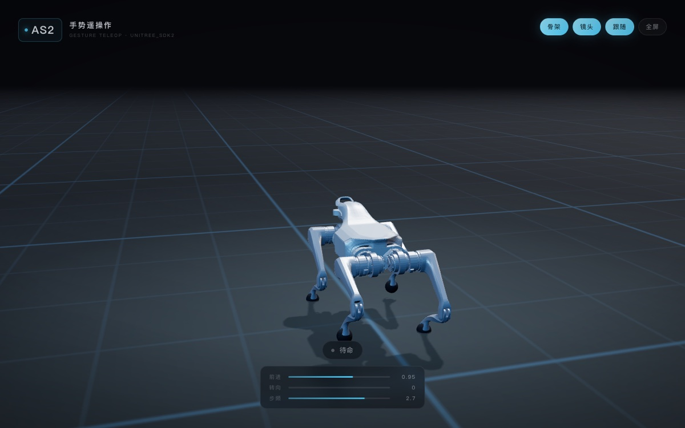

# AS2 · 手势遥操作

> 举起一只手，把宇树 AS2 机器狗开起来。

浏览器里跑的手势遥操作 Demo：手在画面里的位置就是一根摇杆 —— 抬高前进、压低后退、左右转向、拇指食指捏合刹车。机器狗用 `unitree_mujoco` 官方的 AS2 网格，腿部走真实的两连杆逆运动学 + trot 步态。

识别全部在本机完成（MediaPipe WASM + GPU 推理），画面不上传。



## 快速开始

摄像头 API 要求安全上下文，`file://` 打不开，必须走 HTTP：

**macOS**：双击 `启动.command`，会自动起服务并打开浏览器。

**手动**：

```bash
python3 -m http.server 8124
# 打开 http://127.0.0.1:8124/
```

首次打开要先载入 13MB 的 AS2 网格，本地读取大约 1～2 秒；之后有缓存。

## 手势对照

| 手势 | 效果 |
|---|---|
| 手掌抬高（画面上方） | 前进，最高 1.5 m/s |
| 手掌压低（画面下方） | 后退，最高 0.7 m/s |
| 手掌左右移动 | 转向，最大 ±66 °/s |
| 拇指与食指捏合 | 刹车，速度立刻归零 |
| 手离开画面 | 0.7 秒后平滑收油，自己停下 |

手的**位置**映射成速度，松手才停 —— 不是"做一次动作走一步"。这样操作是连续的，跟真正的摇杆一样。

右上角「镜头」显示摄像头画面并叠加手部 21 个关键点，拇指与食指之间那条白色虚线就是刹车"弦"。触控板 / 鼠标也能玩（启动页第二个按钮），方向键同样可用。

## 技术

**模型** — 直接取 [unitree_mujoco](https://github.com/unitreerobotics/unitree_mujoco) 里 `unitree_robots/as2` 的 STL 与 MJCF 尺寸，在 Three.js 里按 MJCF 的层级重建：`base_link → hip(绕 x) → thigh(绕 y) → calf(绕 y) → foot`。躯干和腿沿用 MJCF 坐标（z 向上），最外层转成 three 的 y-up，所以关节轴不用改符号。

**腿部逆运动学** — 每帧给定四只脚的目标位置，反解三个关节角。关键是**大腿相对髋的横向偏置 0.1054m 会随髋关节一起转**，腿平面不是过髋原点而是过转动后的大腿根。忽略这一项，站立时四条腿会外撇近 20°。闭式解：

```
d = |目标|,  pz = -√(d² - dx² - dyOff²)
q_hip  = atan2(dz, dy) - atan2(pz, dyOff)
然后对 (dx, -pz) 做平面二连杆 IK 得 q_thigh / q_calf
```

数值验证误差 0.000mm，站立姿态髋角为 0°。

**trot 步态** — 对角腿同相（FL+RR / FR+RL 相差半个周期），支撑相 55%。每只脚在支撑相里按机身速度（含转向的切向分量 `ω × r`）向后滑，摆动相抬脚前送。速度决定步频和步长：`f = 1.7 + 1.05·v`，所以走得越快频率越高，停下时相位回收、四脚归位。

**和官方 SDK 的对应** — `unitree_sdk2py/as2/sport/SportClient` 的接口是 `Move(vx, vy, vyaw)`、`BalanceStand()`、`StandUp()`、`Damp()`。本项目的速度指令就是 `Move` 的三个参数，捏合刹车对应 `Damp`。所以接真机时，只需要把 `sim.cmd` 转发给 SportClient，上层手势逻辑一行不用改。

## 边界说明（重要）

**这是运动学可视化，不是物理仿真。** 腿是按 IK 算出来摆动的，没有刚体动力学、没有地面反作用力，所以不会摔、不会打滑、也无法验证控制器稳定性。

原因在仿真器那一侧：`unitree_mujoco` 目前只实现底层接口 —— 订阅 `rt/lowcmd` 用关节 PD 力矩驱动，发布 `LowState` / `SportModeState`，**没有实现 `sport` 这个 RPC 服务**（readme 里写明"当前版本仅支持底层开发"）。所以在 MuJoCo 里直接调 `SportClient.Move()` 是没有反应的，不是参数不对，是服务端不存在。想在那套仿真里让 AS2 走起来，得自己写步态发 `LowCmd`。

这套东西适合做演示、教学和交互验证；要做控制算法验证，需要另接 MuJoCo 或 Isaac。

## 目录

```
index.html
启动.command            双击即开
css/style.css
js/main.js              场景、手势指令、主循环
js/robot.js             STL 加载与关节层级
js/gait.js              逆运动学 + trot 步态（纯函数，可用 node 单独测）
js/hand-tracker.js      MediaPipe 手部识别（来自同目录的 gesture-flower 项目）
meshes/                 AS2 网格（7 个 STL，约 13MB）
vendor/                 three.js、STLLoader、MediaPipe 运行时
as2.xml                 原始 MJCF，尺寸与关节轴参照用
```

所有资源都**优先读本地、失败回退 CDN**：网格缺失时从 `unitree_mujoco` 的 raw 地址拉，识别引擎与模型从 jsDelivr 拉。

仓库里**不含** `wasm/` 与 `models/`（约 17MB 的推理运行时和手部模型），第一次点「开启摄像头」时从 CDN 加载，约几秒，之后走浏览器缓存。想完全离线用，把这两个目录放回根目录即可，代码会自动优先读本地。

## 调试入口

```
?auto=0.9&warm=150        自动驾驶 0.9 m/s，先预热 150 步（截图用）
?auto=0.9&side=1          侧视镜头
?fx=0.8&fy=0.2&op=1       不用摄像头，直接注入一只"合成手"验证映射
?diag=1                   左下角显示渲染与仿真数据
```

`window.__sim` 暴露了 `sim` / `gait` / `robot`，控制台里可以直接 `__sim.setCmd(0.8, 0, 0.5)`。

## 可调参数

- 站立高度：`js/gait.js` 的 `this.height = 0.285`
- 抬脚高度 / 支撑占空比：`this.lift` / `this.duty`
- 速度上限：`js/main.js` 的 `LIMITS`
- 手势灵敏度：`applyGesture` 里的 `/ 0.3` 和 `deadzone` 阈值
- 跟随镜头距离：`updateCamera` 里的 `-2.05` / `0.72` / `0.98`

## 许可

代码 MIT。AS2 网格与 MJCF 来自 [unitree_mujoco](https://github.com/unitreerobotics/unitree_mujoco)（BSD-3-Clause），手势识别依赖 [MediaPipe](https://github.com/google-ai-edge/mediapipe)（Apache-2.0）。
